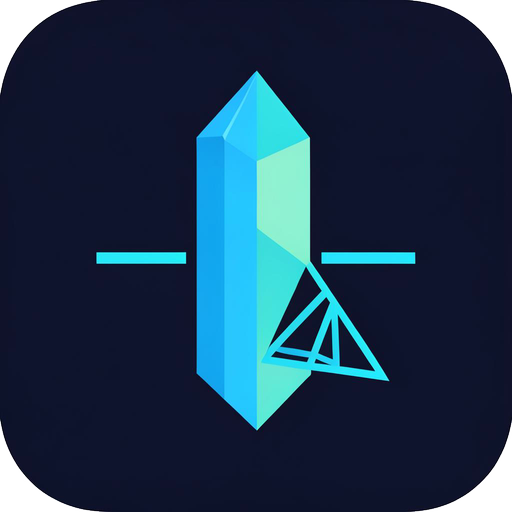

# Bismuth
Rendering optimization mod with the goal of fully
rewriting the rendering side of Geometry Dash
for maximum performance.

Currently experimental

## iOS Metal compute track

The `ios-metal-compute` branch targets Metal compute for per-sprite transforms
and visibility, with OpenGL ES retained for drawing. It explicitly rejects
per-frame CPU per-sprite preparation. See
[docs/IOS_METAL_COMPUTE_ARCHITECTURE.md](docs/IOS_METAL_COMPUTE_ARCHITECTURE.md)
for the architecture guardrails and current integration status.

The iOS work is not yet built or device-tested.

You can try the latest upstream builds from the discord server: https://discord.gg/MDbQt3w8HC

## License

Bismuth - Optimization mod for Geometry Dash

Copyright (C) 2026 IliasHDZ

If the program has been modified using AI, you CANNOT DISTRIBUTE
a binary of the modified program.

This project also CANNOT BE USED UNDER ANY CIRCUMSTANCES TO
FACILITATE OR ADVANCE GEOMETRY DASH LEVEL GENERATION OR
MODIFICATION USING GENERATIVE AI.

Except for the above clauses, the GPL v3 license applies:

This program is free software: you can redistribute it and/or modify
it under the terms of the GNU General Public License as published by
the Free Software Foundation, either version 3 of the License, or
(at your option) any later version.

This program is distributed in the hope that it will be useful,
but WITHOUT ANY WARRANTY; without even the implied warranty of
MERCHANTABILITY or FITNESS FOR A PARTICULAR PURPOSE.  See the
GNU General Public License for more details.

You should have received a copy of the GNU General Public License
along with this program.  If not, see <https://www.gnu.org/licenses/>.
