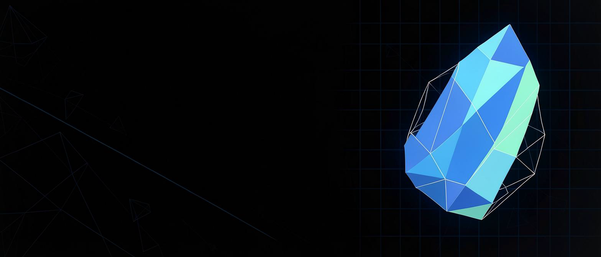
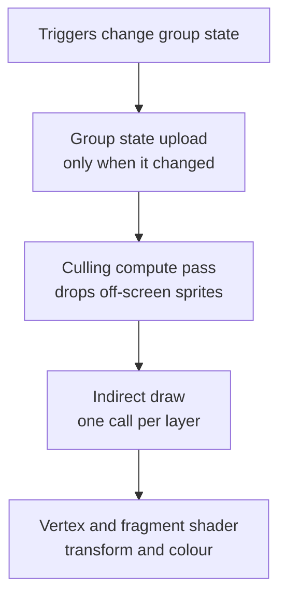

<p align="center">
  
</p>

<h1 align="center">Kyanite</h1>

<p align="center">
  <b>Geometry Dash's object renderer, moved to the GPU.</b><br>
  Culling, group transforms, triggers and batching are resolved in compute and vertex shaders instead of on one CPU thread.
</p>

<p align="center">
  <a href="https://geode-sdk.org"></a>
  
  
  
  <a href="LICENSE"></a>
</p>

<p align="center">
  <a href="#why-the-cpu-was-the-problem">Why</a> ·
  <a href="#numbers">Numbers</a> ·
  <a href="#a-frame-in-kyanite">How it works</a> ·
  <a href="#feature-status">Status</a> ·
  <a href="#install">Install</a> ·
  <a href="#settings">Settings</a> ·
  <a href="#compatibility">Compatibility</a> ·
  <a href="#building">Building</a> ·
  <a href="#roadmap">Roadmap</a> ·
  <a href="#faq">FAQ</a> ·
  <a href="https://discord.gg/B6H6ZVJx9C">Discord</a>
</p>

A fork of [Bismuth](https://github.com/iliasHDZ/Bismuth) by IliasHDZ, continued as
Kyanite. Shaders, UI and particles are untouched; Kyanite only takes over level
objects.

## Why the CPU was the problem

Geometry Dash draws a level the way a 2013 mobile engine does: every object is a
`CCSprite`, every sprite is placed by the CPU, and every trigger that moves,
rotates, fades or toggles a group walks the objects of that group and updates
them one by one. A move trigger that targets a group with 5,000 objects touches
5,000 objects per activation. At a few hundred thousand objects a level spends
more time updating sprites than it spends drawing them, and every frame gets
slower the more triggers fire.

Kyanite removes that work instead of making it faster:

- object data is uploaded once, at level load, and never rebuilt per frame
- move, rotate, follow, toggle, alpha and pulse triggers update a **per-group
  state** instead of the objects in the group, so a trigger touches one entry
  regardless of how many objects it targets
- off-screen objects are dropped by a compute shader before anything is drawn
- the draw order is a GPU buffer, executed with one indirect draw per layer

The result is a frame whose CPU cost barely depends on object count.

## Numbers

One test level, measured in game: **273,266 objects**, **368,931 sprites**,
943 group combinations, 632 transform combinations, culled by 68 compute work
groups.

| Build | FPS |
|---|---|
| Peaceful, before the parallel culling fix | below 40 |
| Peaceful, current build | above 500 |

Every 5 seconds the mod logs where the frame went:

```
Frame timing: 1042 FPS (0.96 ms/frame) | uniforms 3 us | color channels 4 us
 | group states 6 us (alpha 3, pulse 1, upload 2) | culling 11 us (sorted batch 0, 0 regen)
 | draw 48 us | other 888 us
```

`uniforms`, `color channels`, `group states`, `culling` and `draw` are Kyanite's
own cost. `other` is the rest of the frame: the game's update, UI, physics and
buffer swap. If `other` is the only large number, Kyanite is not what is holding
the level back, and no renderer change will make that level faster.

The log line is the honest way to measure this mod: it separates Kyanite's cost
from the game's. Turn it off with *Log frame timing* once you are done tuning.

## A frame in Kyanite



`src/renderer/Renderer.cpp` drives this: uniforms, group state, the culling
dispatch, then the layer nodes draw from the buffers the compute pass filled in.
The long version, with how GD builds sprite batches and why the culling pass
writes indices with a shared-memory scan, is in
[TechnicalExplanation.md](TechnicalExplanation.md).

## Feature status

| Feature | Status |
|---|---|
| Rendering levels (GD 2.2081, Geode 5.11.2) | ✅ |
| Move, rotate, follow, toggle, alpha and pulse triggers | ✅ |
| Color channels, HSV, glow, blending modes | ✅ |
| Hitbox viewers (MegaHack, GD Mega Overlay, debug draw, on death) | ✅ |
| Checkpoints and level restarts | ✅ |
| Overdraw view, in-game toggle, difference mode | ✅ under *Debug tools* |
| Scale trigger (2067), area/enter effects (3006+), advanced follow, keyframes | ⚠️ the level renders, the objects those triggers touch keep their start transform |
| 2.2-only visuals (platformer camera and friends) | ❌ |
| Intel integrated GPUs | ⚠️ often slower than vanilla |

## Install

1. Install [Geode](https://geode-sdk.org/install/) for **Geometry Dash 2.2081**.
2. Drop `iliashdz.kyanite.geode` into `Geometry Dash/geode/mods`.
3. Launch the game. A level with a lot of objects should now log a frame
   breakdown every 5 seconds in `geode/logs`.

If you used Bismuth before, delete `iliashdz.bismuth.geode`: Geode treats the
two ids as different mods and would load both renderers, which is slow and
unstable.

Nightly builds are posted in the [Discord](https://discord.gg/B6H6ZVJx9C).

## Settings

| Setting | Default | What it does |
|---|---|---|
| Kyanite enabled | on | Master switch. Off draws levels with GD's own renderer |
| Log frame timing | on | The 5 second breakdown above |
| GPU core count | `0` | Work groups used by the culling pass. `0` detects the count; set it by hand if detection fails (mostly AMD) |
| Debug tools | off | F8 toggles the renderer while playing, F9 difference mode, F7 selects objects right of the screen in the editor. Turns the optimizations off |
| Persistently mapped buffers | off | Buffer writes go through a persistent mapping. Buggy on many drivers, occasionally helps on integrated GPUs |
| Disable object pulse | off | Objects stop pulsing to the song |

F3 shows the renderer overlay, F4 the overdraw view.

## Compatibility

### Hitboxes

Hitbox viewers draw the game's own hitbox rectangles. Kyanite keeps its
optimizations while they are open: objects on screen are activated invisibly so
the game computes their hitboxes, everything off screen stays culled. Hitboxes
line up with what is on screen, including objects moved or rotated by triggers.

### Versions

Built for **Geometry Dash 2.2081** with **Geode 5.11.2**. The same source also
builds for **2.2091** with the **6.x SDK**: set `geode` to `6.0.0-beta.1` and
`gd.win` to `2.2091` in `mod.json`, then build with that SDK and its bindings.
The only version difference (`PlayLayer::init` arguments) is behind a
`GEODE_COMP_GD_VERSION` check. Geode refuses a `.geode` built for the other
version, so use the build that matches your loader.

### Triggers

Group based triggers run on the GPU: move, rotate, follow, toggle, alpha and
pulse. Every other trigger keeps working, because it does not change how objects
are drawn.

Per-object effects are the remaining gap. The Scale trigger, Area and Enter
effects, Advanced Follow and keyframes change each object on its own, which a
per-group state cannot describe. Levels that use them still render at Kyanite
speed, but the objects those triggers touch keep their initial transform. Giving
those effects a per-object transform buffer is the next piece of work, tracked in
[TODO.md](TODO.md).

Objects from a sprite sheet the renderer has no mesh for are skipped; the rest of
the level renders normally.

## Building

Kyanite is built with the [Geode SDK](https://docs.geode-sdk.org/).

On Windows:

```
geode build
```

On Linux (cross-compiling for Windows):

```
geode sdk install-linux
geode build -p windows
```

If the SDK helper can't download the Windows SDK, the toolchain can be wired up
by hand:

1. `xwin --accept-license --arch x86_64 splat --output ./xwin-splat` (xwin 0.10+)
2. LLVM/clang 19 or newer, with `clang-cl`, `lld-link`, `llvm-lib`, `llvm-mt`,
   `llvm-rc` and `llvm-nm`
3. Configure:

```
cmake -S . -B build-win -G Ninja \
  -DGEODE_TARGET_PLATFORM=Win64 \
  -DCMAKE_TOOLCHAIN_FILE=<geode-sdk>/clang-cl-msvc.cmake \
  -DSPLAT_DIR=./xwin-splat -DHOST_ARCH=x86_64 \
  -DLLVM_VER=19 -DCLANG_VER=19 -DLLVM_PATH=<llvm>/bin \
  -DCMAKE_MSVC_RUNTIME_LIBRARY=MultiThreadedDLL
cmake --build build-win
```

Pushing to this repository also builds a Windows `.geode` through the GitHub
Actions workflow in `.github/workflows/multi-platform.yml`.

`CMakeLists.txt` builds with `/Ob3 /Oi /Ot` for the mod target. Link time code
generation is deliberately off: `/GL` drops the inline assembly stubs the Geode
bindings use to resolve game functions and the mod stops linking.

## Project layout

| Path | What lives there |
|---|---|
| `src/renderer` | Renderer, batching, group state, buffers, shaders, hooks |
| `src/decomp` | Decompiled game functions that Kyanite reimplements |
| `resources/shaders` | GLSL for the culling compute pass and object drawing |
| `SpriteMeshEditor` | Tool used to author the convex sprite meshes in `spriteMeshes.json` |
| `TechnicalExplanation.md` | Long form explanation of how the renderer works |

## Roadmap

- Per-object transforms so Scale, Area/Enter and Advanced Follow effects work
- More batch candidates for the sorted cache, so blend-heavy levels stop
  regenerating
- Optional GPU timing queries next to the CPU frame breakdown
- 2.2 visuals

## FAQ

**Does it work on every level?** Yes. Every level renders. Levels with
per-object effects lose those specific animations (see
[Triggers](#triggers)), everything else works.

**Is it faster on my machine?** On a dedicated GPU, almost always on object
heavy levels. On Intel integrated GPUs the extra compute pass can cost more than
the CPU work it replaces, and the mod says so.

**Does it change physics or hitboxes?** No. Only how objects are drawn and how
group state is applied. The game still computes physics, hitboxes and triggers.

**Can I turn it off?** Yes, *Kyanite enabled* in the mod settings, or F8 while
playing with *Debug tools* on.

**Why does the log say `other` is most of the frame?** Because the rest of the
game is most of the frame. Kyanite reports its own cost separately on purpose.

## Credits

- [IliasHDZ](https://github.com/IliasHDZ): original author of Bismuth, which
  this fork is based on.
- [glm](https://github.com/g-truc/glm), [glslang](https://github.com/KhronosGroup/glslang)
  and [OpenCL-Headers](https://github.com/KhronosGroup/OpenCL-Headers): the
  libraries the renderer builds on.
- [Geode SDK](https://github.com/geode-sdk/geode): the mod loader.
